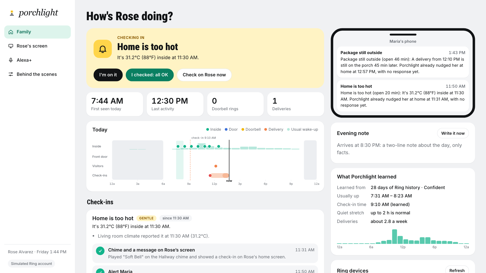
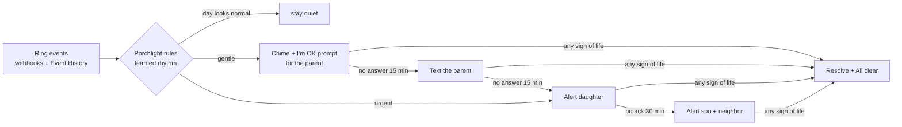
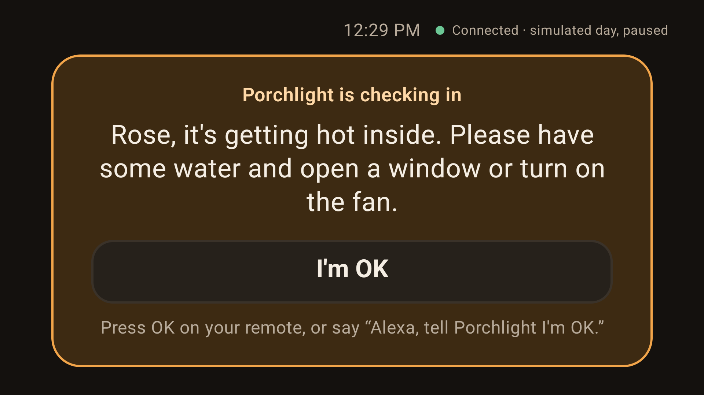
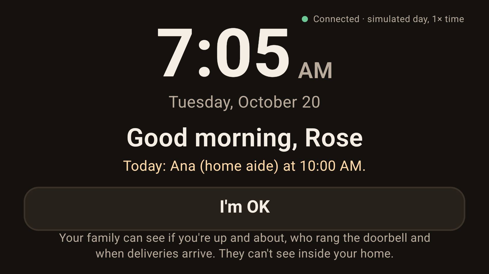
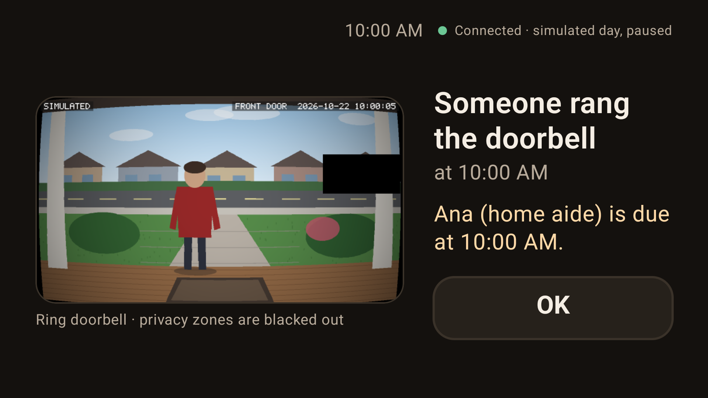

# Porchlight

**Ring tells you when something happens. Porchlight notices when something doesn't.**

Porchlight is a caregiving app for the Ring Appstore. It uses the Ring devices already at an older parent's home (a doorbell, an indoor camera's motion events, a door sensor, a chime) to learn the shape of their ordinary day. When a day looks wrong, it checks in gently: first with the parent, then with family. The triggers are a quiet morning, an unanswered doorbell, a pharmacy box left in the heat, or the front door opening at 3 AM.

> Ring's own Appstore lists **"Elderly care monitoring"** as a category it is waiting for. Porchlight is built to be that app.



## Why

More than a quarter of Americans over 65 live alone ([ACL, Profile of Older Americans](https://acl.gov/aging-and-disability-in-america/data-and-research/profile-older-americans)), and about one in four older adults falls each year ([CDC](https://www.cdc.gov/falls/data-research/index.html)). The family's real question is rarely "what happened at the door?" It is "**is Mom up and about today?**" Security cameras answer the first question. Nothing in the home answers the second without wearables, new hardware, or a camera pointed at the person.

Porchlight answers it with hardware the family already owns, and without looking inside the home.

## What it does

| Check-in | How Porchlight notices | First response |
|---|---|---|
| **Quiet morning** | No sign of life by the check-in time it **learned** from 4 weeks of Ring event history (the latest usual start plus 45 min) | Good-morning chime + "I'm OK" prompt for the parent |
| **Unusually quiet** | Active earlier, then silent far longer than a normal quiet stretch for this person | Same, gentle |
| **Doorbell not answered** | The scheduled aide rang and nobody opened the door within 4 minutes | Urgent: daughter alerted at once |
| **Package still outside** | Ring's own `package_delivery` classification starts a timer; when it expires, a **privacy-masked snapshot** goes to a vision model on Amazon Bedrock | Reminder chime + "I brought it in" button |
| **Front door at night** | Door sensor opens during quiet hours | Urgent: alert with an infrared snapshot |
| **Home too hot / cold, water, CO** | Ring sensor threshold webhooks | Nudge, then family (CO alerts carry a "this is not a CO alarm" caveat) |
| **Camera offline** | `device_offline` for 30 min | Tells the family Porchlight is blind, instead of silently failing |

**The escalation ladder.** The parent always gets the first chance, by chime and screen, or by voice through Alexa+. Then comes a text. Only then is the primary caregiver alerted, and after that the rest of the circle. One tap of "I'm on it" stops everyone else being woken up. When it resolves, everyone who was told gets an "All clear". No one else is bothered if the parent simply answers.



## How it uses the Ring Partner API

Everything goes through [`ring-partner-kit`](packages/ring-partner-kit), a typed, zero-dependency client I wrote for this project and released separately as open source at [pswapnajit/ring-partner-kit](https://github.com/pswapnajit/ring-partner-kit).

| Ring API | What Porchlight does with it |
|---|---|
| `GET /v1/devices?include=status,capabilities,configurations,location` | Discovery in one round trip. Roles are proposed from capabilities (Ring has no device-type field), and chimes are detected by `audio.customizable_slots` |
| `GET /v1/history/devices/{id}/events` with composite filters (`motion.human`, `motion.package_delivery`, …) and `page[key]` pagination | Learns the routine from 28 days of history. In live mode with the Developer Playground (no webhooks), it is also the event feed |
| Webhooks: `motion_detected` (+ `sub_type`), `button_press`, `contact_sensor_*`, `temperature_*`, `device_offline/online` | Real-time signals. HMAC-SHA256 is verified over the raw bytes, deduplicated on `meta.request_id`, and the handler answers fast and processes afterwards |
| `POST /v1/devices/{id}/media/image/download` (`latest_in_range`, PNG, 303 to a pre-signed URL) | Porch checks and night snapshots. **Privacy zones from `configurations` are blacked out before any model or person sees the image** |
| `POST /v1/devices/{id}/media/audio/playback` | Good-morning and reminder chimes in the home, gated on online, snooze and enabled slot, and never retried |
| `GET /v1/devices/{id}/configurations` → `e2e_encryption` | Skips vision on encrypted cameras and asks a person instead |
| `POST .../media/streaming/whep/sessions` | "Live view" button for the family, over WebRTC (live mode) |

Ring's [computer-vision guidelines](https://developer.amazon.com/docs/ring/computer-vision-guidelines.html) recommend a tiered funnel. Porchlight follows it: Ring's free `sub_type` classification is stage 0, and the expensive model runs once per decision, never per motion event.

## Privacy and dignity by design

- **Nothing inside the home is ever viewed.** Indoor cameras contribute only "there was movement at 7:41".
- **Snapshots are taken only when a decision depends on one**, or when the doorbell rings so the parent's own TV can show who is there. They come only from the front door, with Ring privacy zones masked before anything else happens. Only the masked, downscaled image is kept, and a doorbell snapshot is never sent to a model.
- **The parent comes first.** Every gentle check-in starts with them, and their home screen says plainly what the family can and cannot see.
- **Who gets told, and when, never depends on a model.** The rules and ladder are deterministic and tested. AI only writes the evening note, answers questions and looks at the porch; anything uncertain (`"unsure"` or confidence below 0.6) becomes "ask a person", never a guess.
- **Granular alerts:** each family member chooses which check-ins reach them (opt down, not just out). Quiet hours silence the chime.
- One-click **delete all data** (Ring UX guide requirement).

## Run it

Requires Node.js 22.18 or newer. No keys are needed for the simulated demo.

```bash
npm install
npm run demo        # simulated Ring account with 4 weeks of history -> http://localhost:4000
npm test            # 41 tests: SDK, engine, end-to-end scenarios, MCP
```

The **Behind the scenes** tab plays scripted days: an ordinary day, a quiet morning, a package in the heat, the door opening at 2:48 AM, and an aide who can't get in. Events reach Porchlight as signed webhooks and Ring API calls, exactly as they would from devices.

**Live Ring API (Developer Playground, no device needed):** put a Playground token in `.env` as `RING_ACCESS_TOKEN`, then run:

```bash
npm run probe       # checks the token: devices, history, a snapshot
npm start           # Porchlight against api.amazonvision.com
```

Simulate Package, Vehicle or Motion events in the Playground and watch Porchlight react.

**Amazon Bedrock:** add `AWS_BEARER_TOKEN_BEDROCK` (a Bedrock API key) to `.env`. The vision check, evening note and "Ask Porchlight" then use Bedrock. Without it they fall back to clearly labeled offline behavior.

## Built with AWS

- **Amazon Bedrock (Converse API)**: image + text input to a vision model (default `amazon.nova-lite`) for the porch check, with a strict JSON contract and confidence guardrail. A text model (default `amazon.nova-pro`) writes the evening note from structured facts only.
- **Strands Agents SDK (TypeScript)**: "Ask Porchlight" is a Strands agent on Bedrock with six tools over Porchlight's records and the live Ring camera (`get_day_summary`, `get_open_checkins`, `get_recent_activity`, `get_usual_routine`, `check_porch_now`, `get_devices`).

## Alexa+

`/mcp` is a self-hosted **MCP server (Streamable HTTP, protocol 2025-11-25)** built with the official SDK. A daughter can say *"Alexa, ask Porchlight how Mom's doing"*, *"…check on Mom"* or *"…I'm handling it"*. The parent can answer a check-in by voice with *"Alexa, tell Porchlight I'm OK"*, which matters for anyone who finds a touchscreen hard. Status tools link an **MCP Apps** card (`ui://porchlight/status-card.html`). The Alexa+ tab is a simulated host that is a real MCP client and shows the JSON-RPC traffic.

## Fire TV

[`apps/porchlight-tv`](apps/porchlight-tv) puts Rose's screen on the TV she already watches. It is a native Fire OS app (Kotlin, Jetpack Compose for TV with `androidx.tv`), modelled on Amazon's [`hello-world-fire-tv`](https://github.com/AmazonAppDev/hello-world-fire-tv) sample, and a client of the same Porchlight server (`/api/state`, the `/api/events` stream, `/api/resident/ok`, `/api/resident/package-inside`, `/api/snapshots/:id`).



- **Ambient:** a large clock, a greeting, today's care visit, and the same promise as her home screen: "Your family can see if you're up and about… They can't see inside your home."
- **Check-in:** when Porchlight checks in, the TV shows one calm full-screen card with one big focused button ("I'm OK", or "I brought it in" for a package), and reads the message aloud with Android TextToSpeech. The OK button on the remote answers it. Voice still works through the Alexa+ tool `resident_im_ok`: *"Alexa, tell Porchlight I'm OK."*
- **Doorbell:** when the doorbell rings, the privacy-masked Ring snapshot and, if the care schedule expects someone then, who is due ("Ana (home aide) is due at 10:00 AM"). That comes from the schedule, never from recognizing a face.
- **Fire OS rules:** `LEANBACK_LAUNCHER`, `android.software.leanback` and `android.hardware.touchscreen` not required, a 320×180 banner, minSdk 28 (Fire OS 7), no Google Play Services. Large type, WCAG AA contrast (the lowest text pair is 6.7:1), an unmistakable D-pad focus state, and no zoom, glow or pulse animations.

| Ambient | Doorbell |
|---|---|
|  |  |

**Build and run on the Android TV emulator** (the hackathon FAQ accepts it for the Fire TV track). Needs JDK 17+ and the Android SDK command-line tools; the Gradle wrapper fetches everything else.

```bash
npm run demo                                         # Porchlight on :4000, in one terminal
cd apps/porchlight-tv
./gradlew assembleDebug                              # set ANDROID_HOME, or sdk.dir in local.properties
sdkmanager "system-images;android-34;android-tv;arm64-v8a"   # x86_64 on an Intel Mac
avdmanager create avd -n porchlight-tv -k "system-images;android-34;android-tv;arm64-v8a" -d tv_1080p
emulator -avd porchlight-tv &
adb install -r app/build/outputs/apk/debug/app-debug.apk
adb shell am start -n io.github.pswapnajit.porchlight.tv/.MainActivity
```

Then open **Behind the scenes** at http://localhost:4000 and play "A package in the heat". The check-in arrives on the TV; press OK on the remote (or `adb shell input keyevent KEYCODE_DPAD_CENTER`) and it resolves.

The emulator reaches the host's server at `http://10.0.2.2:4000`, the default. **On a real Fire TV**, run the server on your network (`HOST=0.0.0.0 npm run demo`, which serves the demo without a login, so only on a network you trust), then sideload the APK with `adb connect <fire-tv-ip>` and point the app at your computer once:

```bash
adb shell am start -n io.github.pswapnajit.porchlight.tv/.MainActivity --es server http://192.168.1.20:4000
```

The app remembers it. You can also build it in with `./gradlew assembleDebug -Pporchlight.server=http://192.168.1.20:4000`.

## Project layout

```
packages/ring-partner-kit/   MIT SDK: client, webhooks, sensors, chime, PNG + privacy masking, simulator
apps/porchlight/src/
  engine/      signals, rhythm learning, rules, escalation ladder (deterministic)
  ring/        Event History backfill + polling
  ai/          Bedrock vision, evening note, Strands agent
  mcp.ts       Alexa+ MCP server
  app.ts       wiring: Ring actions, snapshots, runtime
  demo/        the demo household and scripted days
apps/porchlight/web/   family dashboard, parent's screen, Alexa+ host, control room
apps/porchlight-tv/     Fire TV app (Kotlin, Compose for TV): the parent's screen on their TV
submission/            Devpost text, video script, product feedback and friction log
```

## Honest limitations

- Ring sensors and chimes are in Early Access (dynamic scopes), and the Developer Playground provides cameras. Sensor and chime behavior is built to the documented contract and exercised against the included simulator, not real sensors.
- Texts to the parent and family alerts are shown in the app (plus optional real push via ntfy.sh). SMS and voice calls would come next.
- On Fire TV, a check-in appears only while Porchlight TV is open as the ambient screen. It doesn't yet interrupt other apps.
- The TV app is tested on the Android TV emulator (there is no Fire OS emulator image), not on a Fire TV device.
- Porchlight is not an emergency service or a medical device. It notices absence and asks people to check.

MIT licensed. Made by Swapnajit Patra for the Amazon Developer Hackathon "Build, Ship, Shape" (October 2026).
